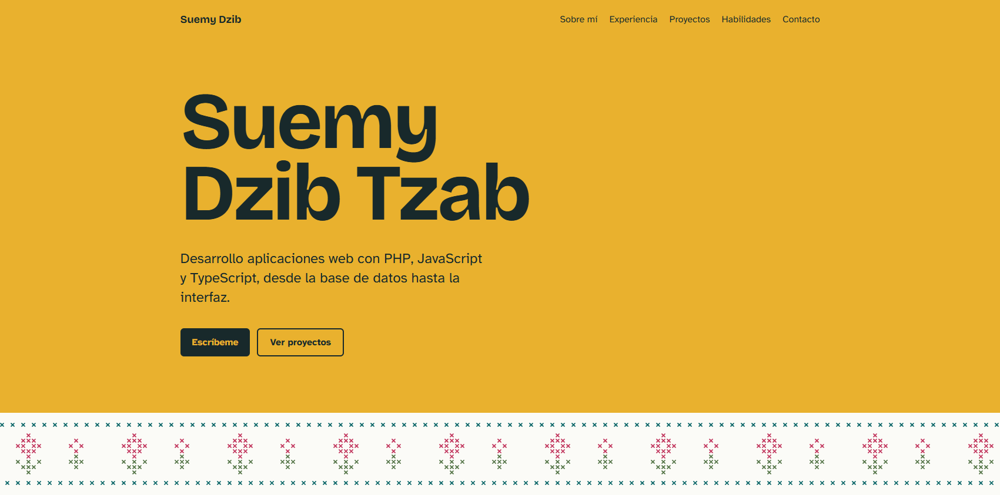

# Portafolio de Suemy Dzib

<<<<<<< HEAD
Sitio personal donde presento mi experiencia, mis proyectos y mis certificaciones como desarrolladora web full stack.

**Ver en línea:** [suemydzib.vercel.app](https://suemydzib.vercel.app)



## Sobre el proyecto

Quería un portafolio que no se viera como una plantilla más, así que el diseño parte de mi origen: soy de Motul, Yucatán. La paleta toma el amarillo de las fachadas de Izamal y el verde azulado de los cenotes, y el encabezado tiene una banda en punto de cruz inspirada en el bordado del hipil, que se "borda" de izquierda a derecha al cargar la página. Las puntadas del bordado se parecen mucho a los píxeles, y esa coincidencia me gustó para un sitio de desarrollo web.

## Características

- **Diseño responsivo y modo oscuro** que se adapta a la preferencia del sistema.
- **Accesibilidad:** enlace para saltar al contenido, navegación completa con teclado, foco visible, textos alternativos, contraste suficiente y animación desactivada para quien prefiere movimiento reducido.
- **SEO técnico:** `sitemap.xml` y `robots.txt` generados por Next.js, URL canónica, metadatos y una imagen para compartir en redes sociales generada automáticamente con `next/og`.
- **Analítica:** Vercel Analytics y Google Analytics 4, además de verificación en Google Search Console.
- **Contenido separado del código:** toda la información (experiencia, proyectos, habilidades y certificaciones) vive en un solo archivo de datos, así que actualizar el sitio no requiere tocar los componentes.
- **Proyectos de ejemplo seguros:** los proyectos marcados como borrador solo se muestran en desarrollo y se ocultan automáticamente en producción.

## Tecnologías

| Área | Herramientas |
| --- | --- |
| Framework | Next.js 15 (App Router), React 19 |
| Lenguaje | TypeScript |
| Estilos | Tailwind CSS 4 con variables de diseño propias |
| Tipografías | Bricolage Grotesque y Atkinson Hyperlegible (vía `next/font`) |
| Gráficos | SVG generado en código para la banda bordada y el ícono |
| Analítica | Vercel Analytics, Google Analytics 4 (`@next/third-parties`) |
| Despliegue | Vercel |

## Estructura

```
src/
  app/
    layout.tsx             Fuentes, metadatos, SEO y analítica
    page.tsx               Secciones de la página
    globals.css            Paleta (modo claro y oscuro) y animación
    opengraph-image.tsx    Imagen para compartir en redes sociales
    sitemap.ts, robots.ts  Archivos para buscadores
    icon.svg               Ícono de la pestaña
  components/
    Section.tsx            Contenedor de cada sección
    StitchBand.tsx         Banda en punto de cruz generada a partir de un patrón de texto
  data/
    portfolio.ts           Todo el contenido del sitio
  lib/
    site.ts                Dirección pública del sitio
```

La banda bordada se define como un patrón de caracteres en `StitchBand.tsx`, donde cada letra es una puntada de un color. El componente convierte ese patrón en un SVG que se repite a lo ancho de la pantalla, así que cambiar el diseño del bordado es tan simple como editar el texto.

## Ejecutar en local

Requiere Node.js 18.18 o superior.
=======
Sitio personal hecho con **Next.js 15, TypeScript y Tailwind CSS 4**.

## Cómo correrlo en tu computadora

Necesitas Node.js 18.18 o superior.
>>>>>>> 8bad1a3787296d49e90abe12e01cccfcf661fe21

```bash
npm install
npm run dev
```

<<<<<<< HEAD
Abre [http://localhost:3000](http://localhost:3000).

### Variables de entorno

Todas son opcionales. Sin ellas el sitio funciona igual, solo sin la integración correspondiente. Para usarlas en local, copia `.env.example` como `.env.local` y llena los valores.

| Variable | Para qué sirve |
| --- | --- |
| `NEXT_PUBLIC_GA_ID` | ID de medición de Google Analytics 4 (`G-...`) |
| `GOOGLE_SITE_VERIFICATION` | Código de verificación de Google Search Console |
| `NEXT_PUBLIC_SITE_URL` | Dirección pública del sitio, si es distinta de `https://suemydzib.vercel.app` |

## Actualizar el contenido

Todo se edita en `src/data/portfolio.ts`:

- **Proyectos:** cada uno lleva título, descripción, tecnologías, enlace a la demo y repositorios. Con `featured: true` aparece entre los destacados y con `personal: true` muestra la etiqueta de proyecto personal.
- **Foto:** se guarda en `public` y se indica su ruta en `profile.photo`.
- **Enlaces:** LinkedIn, GitHub, WhatsApp y CV están en `profile.links`; los vacíos no se muestran.

## Autoría

El código puede consultarse y usarse como referencia. El diseño, los textos y el contenido personal son de mi autoría; si te sirve de inspiración, te agradezco que crees tu propia versión en lugar de copiarlo tal cual.

## Contacto

- Correo: [suemy.dzib.tzab@gmail.com](mailto:suemy.dzib.tzab@gmail.com)
- LinkedIn: [Suemy Ivette Dzib Tzab](https://www.linkedin.com/in/suemy-ivette-dzib-tzab-b004783a9)
- GitHub: [@SuemyDzib](https://github.com/SuemyDzib)
=======
Abre http://localhost:3000.

## Cómo editar tu información

Todo el contenido está en **`src/data/portfolio.ts`**: datos personales, experiencia,
proyectos, habilidades, formación y enlaces. No necesitas tocar los componentes.

### Agregar tus proyectos

1. En `projects`, cambia el título, la descripción y las tecnologías.
2. Pega tus enlaces en `demo` (Vercel) y `repo` (GitHub).
3. Borra la línea `placeholder: true`.

Los proyectos que aún tengan `placeholder: true` solo se ven con `npm run dev`.
En el sitio publicado se ocultan solos, así que nunca verán ejemplos sin terminar.
Si no hay ningún proyecto real, la sección completa se oculta.

Los proyectos con `featured: true` se muestran en grande; los demás aparecen en la lista compacta "Otros proyectos".

### Agregar tu foto

1. Guarda tu foto en la carpeta `public`, por ejemplo `public/foto.jpg`.
   Cuadrada o vertical, de unos 800 px de ancho y menos de 300 KB.
2. En `profile.photo` escribe `"/foto.jpg"`.

La foto aparece en "Sobre mí" con un marco amarillo. Next.js la optimiza automáticamente.
Si dejas el campo vacío, no se muestra.

### Enlaces opcionales

En `profile.links` agrega tu LinkedIn, GitHub y un enlace a tu CV.
Para el CV puedes poner tu PDF en la carpeta `public` como `cv.pdf` y escribir `"/cv.pdf"`.
Los enlaces vacíos no se muestran.

## Publicarlo en Vercel

1. Sube esta carpeta a un repositorio de GitHub.
2. En https://vercel.com, elige "Add New Project" e importa el repositorio.
3. Vercel detecta Next.js automáticamente; solo da clic en "Deploy".

Cada vez que hagas `git push`, el sitio se actualiza solo.

## Estructura

```
src/
  app/
    layout.tsx      Fuentes, metadatos y estructura HTML
    page.tsx        Todas las secciones de la página
    globals.css     Paleta de colores (modo claro y oscuro) y animación
  components/
    Section.tsx     Contenedor de cada sección
    StitchBand.tsx  Banda en punto de cruz inspirada en el hipil yucateco
  data/
    portfolio.ts    Todo tu contenido
```

## Estadísticas de visitas (Vercel Analytics)

El proyecto ya incluye Vercel Analytics. Para activarlo, entra a tu proyecto en Vercel,
abre la pestaña **Analytics** y da clic en **Enable**. A partir del siguiente despliegue
verás cuántas personas visitan tu portafolio y desde dónde llegan.

## Google Search Console y Google Analytics

El código ya está listo; solo necesitas agregar dos variables de entorno en Vercel
(Settings › Environment Variables) y volver a desplegar:

| Variable | Valor | De dónde sale |
| --- | --- | --- |
| `GOOGLE_SITE_VERIFICATION` | El código de la etiqueta HTML (solo lo que va en `content="..."`) | Google Search Console › Agregar propiedad › Prefijo de URL › Etiqueta HTML |
| `NEXT_PUBLIC_GA_ID` | Tu ID de medición, por ejemplo `G-ABC123XYZ` | Google Analytics › Administrar › Flujos de datos › Web |

Si tu dirección no es `https://suemydzib.vercel.app`, agrega también `NEXT_PUBLIC_SITE_URL`.

El sitemap queda en `/sitemap.xml` y el archivo para buscadores en `/robots.txt`.
>>>>>>> 8bad1a3787296d49e90abe12e01cccfcf661fe21
